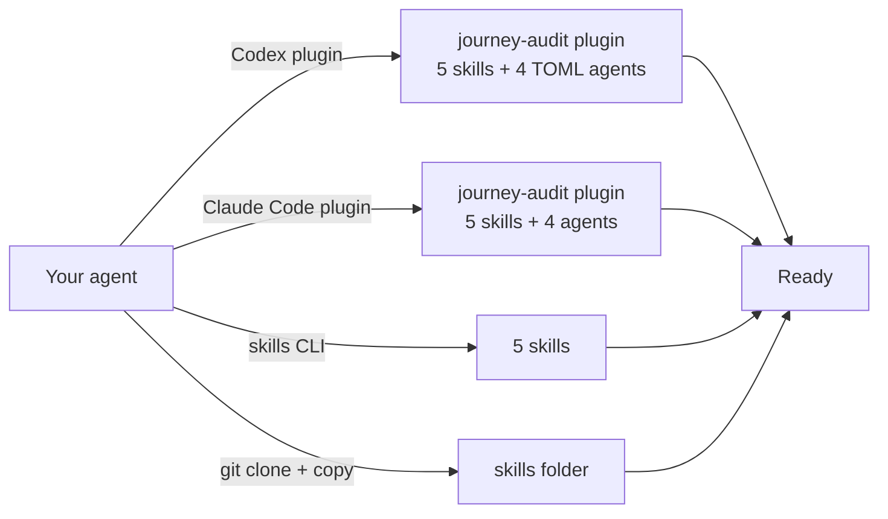
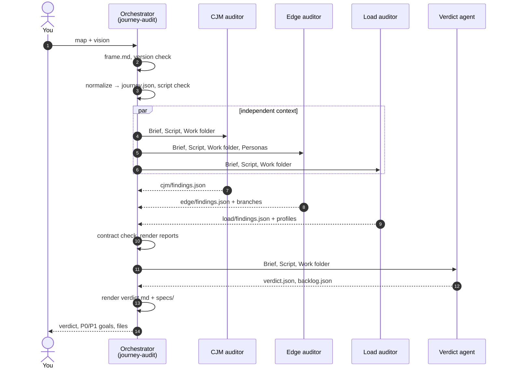
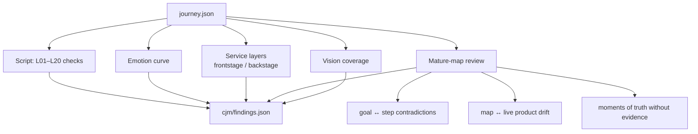
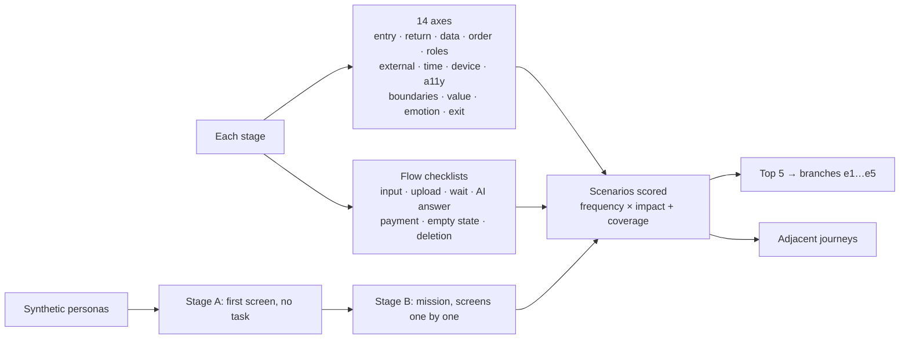
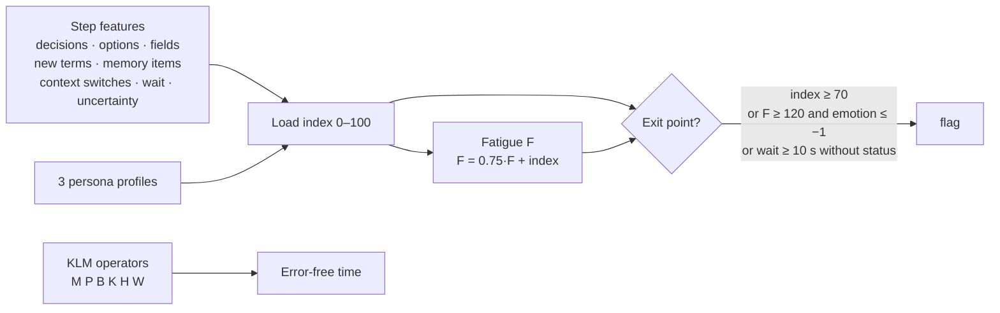
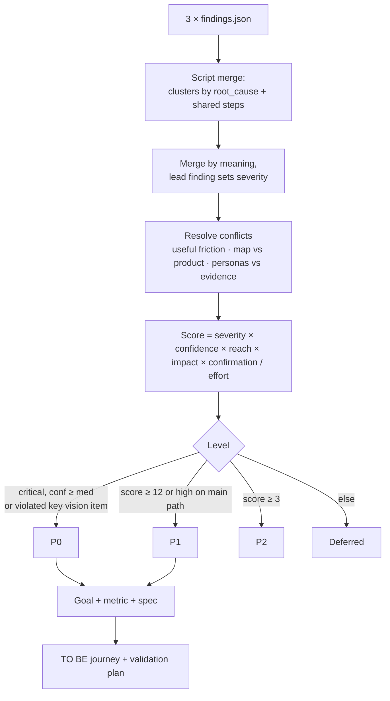

# journey-audit · visual guide

> Русская версия: [GUIDE.ru.md](GUIDE.ru.md)

This guide walks through one audit from input to specs, with diagrams of what happens at each stage and how to read the outputs. The worked example lives in [`examples/card-reissue`](../examples/card-reissue).

- [1. The idea in one picture](#1-the-idea-in-one-picture)
- [2. Install](#2-install)
- [3. Prepare the input](#3-prepare-the-input)
- [4. Run](#4-run)
- [5. What happens inside](#5-what-happens-inside)
- [6. The three auditors](#6-the-three-auditors)
- [7. The verdict](#7-the-verdict)
- [8. Reading the outputs](#8-reading-the-outputs)
- [9. Running one family only](#9-running-one-family-only)
- [10. The script](#10-the-script)
- [11. Limits](#11-limits)

## 1. The idea in one picture


A journey written by an AI model is usually too smooth. Three independent auditors look for three kinds of gaps, and a fourth agent turns their findings into decisions.

| Gap | Typical symptom in an AI-generated journey | Auditor |
|---|---|---|
| **Logic** | Every step succeeds; emotions rise without a reason; a goal in the brief is quietly declined by a later step | CJM logic |
| **Coverage** | No interruption, no return visit, no wrong data, no other role, no external failure | Edge cases |
| **Load** | "User confirms" hides nine options, three new terms and a code to remember | Cognitive load |

## 2. Install



Pick one path from the [README](../README.md#install). The Claude Code plugin also registers the four agent types (in Codex, copy `codex/agents/*.toml` to `~/.codex/agents/`), so the auditors run as real parallel subagents. With the skills-only paths the orchestrator launches general-purpose subagents with the same briefs; without any subagents it runs the auditors one after another.

## 3. Prepare the input

Anything that describes the journey works:

| Input | Example |
|---|---|
| A CJM table or document | `journey-map.md`, a Notion page, a docx, a Figma frame exported as an image |
| A user flow | A list of screens and transitions |
| A prototype or a live URL | Edge auditor can walk it in a browser, read-only |
| Code | Routes, error states, UI copy — used as evidence |
| Owner's vision | 3–5 lines: "the user must…", "we never…" |

The vision matters most: without it the audit can say that a journey is inconsistent, but not that it misses *your* intent. If you skip it, the orchestrator asks for it or reconstructs it from the document and marks it as reconstructed.

## 4. Run

Ask in plain words:

```text
Audit this customer journey map: docs/onboarding-cjm.md.
My vision: the user finishes setup in one sitting; we never ask for data we already have.
```

```text
Проверь CJM в docs/onboarding-cjm.md: логика, краевые сценарии, нагрузка. Дай приоритеты и спеки.
```

Options you can add: "quick mode" (no personas, no expanded branches), "with 4 personas", "walk the prototype at https://…", "only edge cases", "only load", "answer in Russian".

## 5. What happens inside



**Normalization** turns any input into one JSON schema: one action per step, response, emotion with a reason, failure and recovery, load features, branches. Everything the orchestrator had to invent is listed in `frame.md` — that list alone shows where the journey is underspecified.

**Independence.** Auditors never see each other's findings. This is deliberate: a load auditor that has read the logic report starts to agree with it.

**One contract.** All findings share one JSON format with a severity, an evidence class and a `root_cause` label from a fixed list. That is what lets the verdict see that three families found the same cause.

## 6. The three auditors

### CJM logic



The script catches formal gaps (no trigger, failure without a way out, unknown wait, internal terms on screen). The most valuable findings are manual: a goal from the brief that a later step declines, or a map that describes a different product than the one in production.

### Edge cases



Personas are chosen by traits that break journeys (first time, in a hurry, low digital literacy, returning, another role, assistive tech), not by demographics. They never see the intended route before the mission: if a persona goes the wrong way, that is the finding.

### Cognitive load



Example from the card-reissue journey (mid tech, low patience). Bars are the load index, the line is emotion:


High load is then split into **intrinsic** (the job itself — present it more clearly) and **extraneous** (added by the interface — cut it by removing noise, using familiar patterns and taking work off the user). Friction that protects the user is marked `useful_friction` and is never removed.

## 7. The verdict



| Verdict | When |
|---|---|
| Ready | No P0, at most 2 P1 |
| Ready with conditions | No P0, some P1 must ship first |
| Rework | P0 goals solvable within the current journey |
| Redesign | A P0 hits the main job or value |

Every P0 and P1 goal gets a spec that can go straight into a ticket: problem with links to findings, metric (now → target → how to measure), TO BE fragment, states, exact UI copy, Given/When/Then acceptance criteria, analytics events, test cases, what not to break, owner decisions.

## 8. Reading the outputs

```
<work>/
  frame.md                 ← what was assumed
  journey.json             ← normalized journey
  cjm/report.md            ← logic findings, emotion curve
  edge/report.md           ← scenarios, branches, personas
  load/report.md           ← load tables for 3 profiles
  verdict/verdict.md       ← start here
  verdict/specs/G-01.md    ← one spec per P0/P1 goal
  verdict/backlog.json     ← for trackers and scripts
  journey-audit-<slug>.md  ← one-page summary
```

Read in this order: `journey-audit-<slug>.md` → `verdict/verdict.md` → the specs you are going to build → family reports when you need the reasoning.

**Evidence classes** tell you how much to trust a finding:

| Class | Meaning | What to do |
|---|---|---|
| `provided` | Visible in the input (with a file reference) | Act on it |
| `absent` | The input is silent where it must not be | Decide and document |
| `interpretation` | Reasoned reading of the input | Review |
| `synthetic` | A simulated persona did it | Validate with people |
| `hypothesis` | A claim about real users without data | Validate with people |
| `unknown` | Not enough information | Get the information |

## 9. Running one family only

| You want | Ask for | Skill |
|---|---|---|
| Logic of the map | "check only the logic of this CJM" | `journey-cjm` |
| Missing scenarios | "what edge cases did we miss" | `journey-edge` |
| Load | "where will users get tired" | `journey-load` |
| Priorities from existing findings | "prioritize and write specs" | `journey-verdict` |

## 10. The script

`skills/journey-audit/scripts/journey_check.py` — Python 3.8+, standard library only.

| Command | Does |
|---|---|
| `check journey.json` | Structural checks L01–L20 that are visible from data |
| `load journey.json --persona-tech low --persona-patience low` | Load index, KLM, fatigue, exit points |
| `vision journey.json` | Draft vision coverage (by step links — always review) |
| `curve journey.json -o curve.svg` | Emotion + load chart |
| `findings <work>` | Validate the three findings files |
| `merge <work>` | Starting clusters and scores for the verdict |
| `render <work>` | Expand reports and verdict files into markdown |

Add `--lang ru` for Russian output and `--json` for machine-readable output.

## 11. Limits

- The load index is a model with open weights, not a measurement and not a conversion forecast.
- Synthetic personas generate hypotheses; they are not user research.
- The audit does not invent screens: what the input does not show stays `unknown`.
- Service boundaries, legal, medical and financial frames are owner decisions; the verdict lists options, it does not choose.
