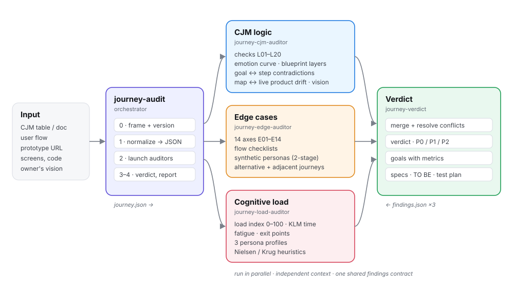
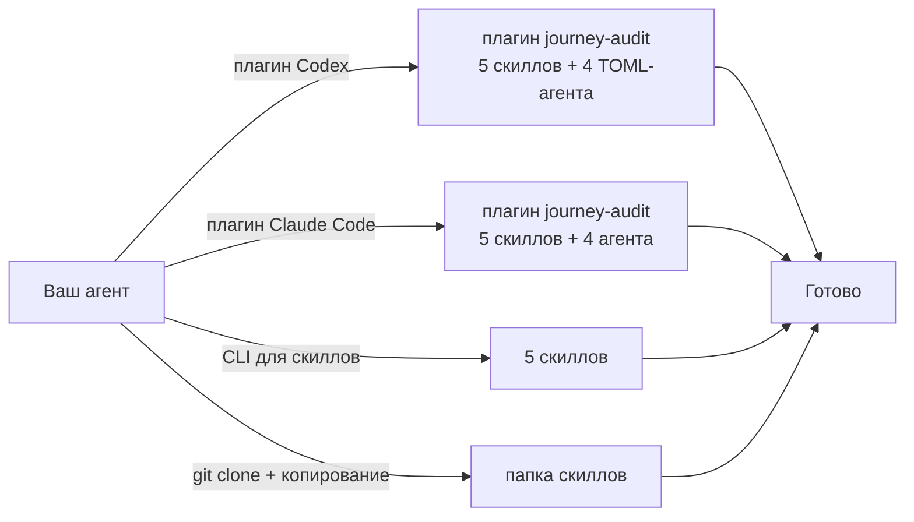
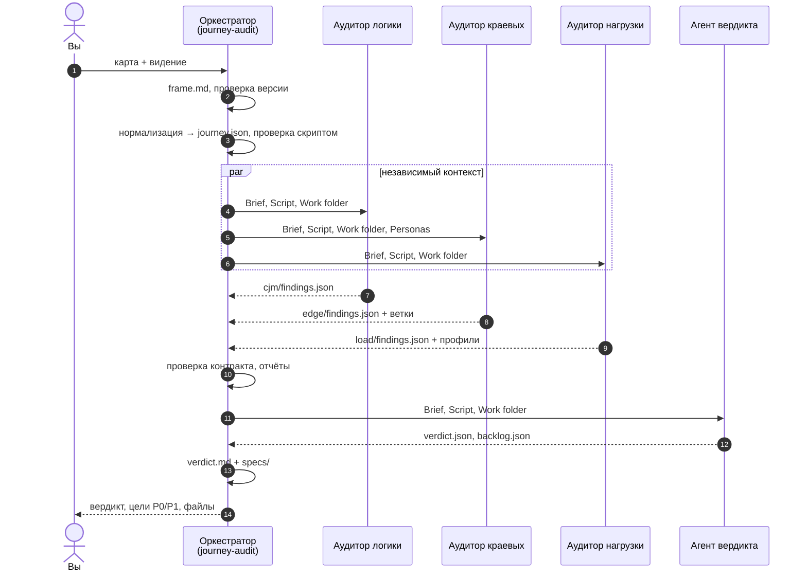
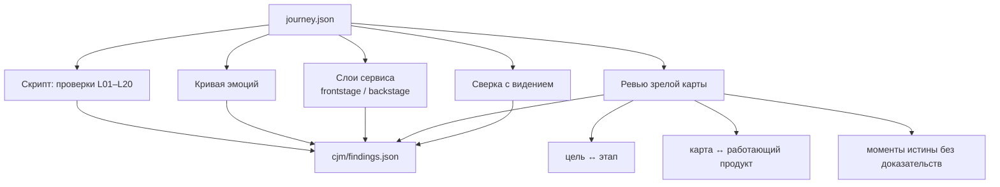
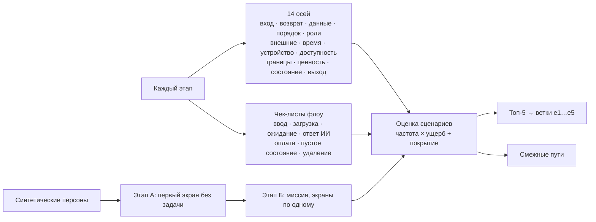
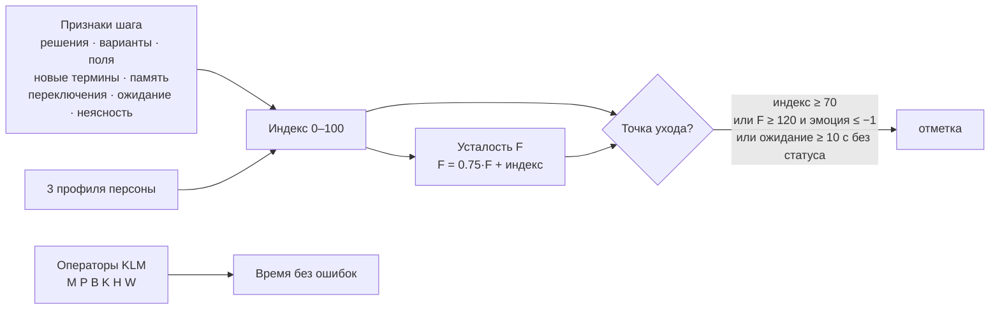
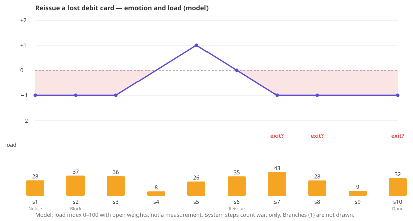
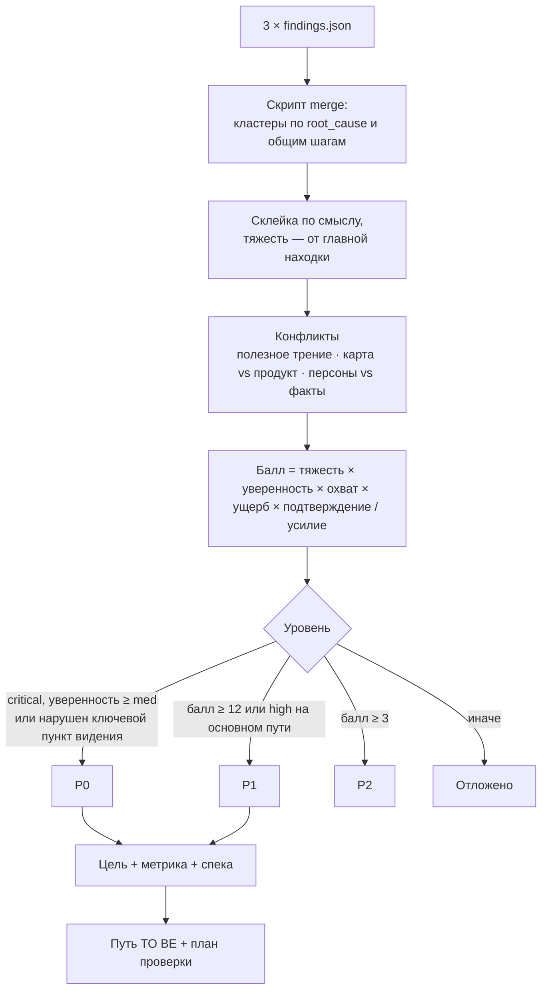

# journey-audit · визуальная инструкция

> English version: [GUIDE.md](GUIDE.md)

Инструкция проводит один аудит от входа до спек: что происходит на каждом этапе и как читать результаты. Разобранный пример — [`examples/card-reissue`](../examples/card-reissue).

- [1. Идея на одной картинке](#1-идея-на-одной-картинке)
- [2. Установка](#2-установка)
- [3. Что подать на вход](#3-что-подать-на-вход)
- [4. Запуск](#4-запуск)
- [5. Что происходит внутри](#5-что-происходит-внутри)
- [6. Три аудитора](#6-три-аудитора)
- [7. Вердикт](#7-вердикт)
- [8. Как читать результаты](#8-как-читать-результаты)
- [9. Одно семейство отдельно](#9-одно-семейство-отдельно)
- [10. Скрипт](#10-скрипт)
- [11. Ограничения](#11-ограничения)

## 1. Идея на одной картинке



Путь, написанный ИИ, обычно слишком гладкий. Три независимых аудитора ищут три типа расхождений, четвёртый агент превращает находки в решения.

| Расхождение | Типичный симптом в пути от ИИ | Аудитор |
|---|---|---|
| **Логика** | Каждый шаг удаётся; эмоции растут без причины; цель из брифа тихо отклоняется на следующем этапе | Логика CJM |
| **Покрытие** | Нет прерывания, возврата, ошибки в данных, другой роли, сбоя внешней системы | Краевые сценарии |
| **Нагрузка** | За «пользователь подтверждает» прячутся девять вариантов, три новых термина и код, который надо помнить | Когнитивная нагрузка |

## 2. Установка



Выберите один путь из [README](../README.ru.md#установка). Плагин Claude Code регистрирует ещё и четыре типа агентов (в Codex — скопируйте `codex/agents/*.toml` в `~/.codex/agents/`) — аудиторы идут настоящими параллельными субагентами. При установке только скиллов оркестратор запускает субагентов общего назначения с теми же брифами; без субагентов — проводит аудиторов по очереди.

## 3. Что подать на вход

Подойдёт всё, что описывает путь:

| Вход | Пример |
|---|---|
| Таблица или документ CJM | `journey-map.md`, страница Notion, docx, кадр Figma картинкой |
| User flow | Список экранов и переходов |
| Прототип или живой URL | Аудитор краевых сценариев пройдёт его в браузере, только чтение |
| Код | Маршруты, состояния ошибок, тексты интерфейса — как доказательства |
| Видение владельца | 3–5 строк: «пользователь должен…», «мы никогда не…» |

Видение важнее всего: без него аудит скажет, что путь противоречив, но не скажет, что он расходится с *вашим* замыслом. Если его нет, оркестратор спросит или восстановит из документа и пометит как восстановленное.

## 4. Запуск

Простыми словами:

```text
Проверь CJM в docs/onboarding-cjm.md: логика, краевые сценарии, нагрузка. Дай приоритеты и спеки.
Моё видение: пользователь проходит настройку за один подход; мы не спрашиваем то, что уже знаем.
```

```text
Audit this customer journey map: docs/onboarding-cjm.md.
```

Что можно добавить: «быстрый режим» (без персон и развёрнутых веток), «с 4 персонами», «пройди прототип по https://…», «только краевые», «только нагрузка», «ответь по-английски».

## 5. Что происходит внутри



**Нормализация** приводит любой вход к одной схеме JSON: одно действие на шаг, отклик, эмоция с причиной, сбой и выход, признаки нагрузки, ветки. Всё, что оркестратору пришлось додумать, перечислено в `frame.md` — этот список сам показывает, где путь недоопределён.

**Независимость.** Аудиторы не видят находок друг друга. Это сделано намеренно: аудитор нагрузки, прочитавший отчёт о логике, начинает с ним соглашаться.

**Один контракт.** Все находки в одном формате JSON: тяжесть, класс доказательности, ярлык `root_cause` из фиксированного списка. Поэтому вердикт видит, что три семейства нашли одну причину.

## 6. Три аудитора

### Логика CJM



Скрипт ловит формальные пропуски (нет триггера, сбой без выхода, неизвестное ожидание, внутренние термины на экране). Самые ценные находки — ручные: цель из брифа, которую отклоняет этап, или карта, описывающая не тот продукт, что работает.

### Краевые сценарии



Персоны подбираются по признакам, которые ломают путь (впервые, торопится, низкая цифровая грамотность, вернулся, другая роль, вспомогательные технологии), а не по демографии. Задуманный маршрут им до миссии не показывают: если персона пошла не туда, это и есть находка.

### Когнитивная нагрузка



Пример из пути перевыпуска карты (tech mid, терпение low). Столбцы — индекс нагрузки, линия — эмоция:



Высокая нагрузка делится на **внутреннюю** (сама задача — показать яснее) и **лишнюю** (добавил интерфейс — убрать шум, опереться на привычные модели, забрать работу у пользователя). Трение, которое защищает пользователя, помечается `useful_friction` и не убирается.

## 7. Вердикт



| Вердикт | Когда |
|---|---|
| Готов | Нет P0, P1 не больше 2 |
| Готов с условиями | Нет P0, часть P1 надо сделать до выпуска |
| Доработать | P0 решаются в рамках текущего пути |
| Переделать | P0 бьёт по главной задаче или ценности |

На каждую цель P0 и P1 пишется спека, которую можно сразу отдать в задачу: проблема со ссылками на находки, метрика (сейчас → цель → как измерить), фрагмент TO BE, состояния, точные тексты интерфейса, критерии приёмки Дано/Когда/Тогда, события аналитики, тест-кейсы, что не ломать, решения владельца.

## 8. Как читать результаты

```
<work>/
  frame.md                 ← что было допущено
  journey.json             ← нормализованный путь
  cjm/report.md            ← логика, кривая эмоций
  edge/report.md           ← сценарии, ветки, персоны
  load/report.md           ← таблицы нагрузки по 3 профилям
  verdict/verdict.md       ← начинать отсюда
  verdict/specs/G-01.md    ← спека на каждую цель P0/P1
  verdict/backlog.json     ← для трекеров и скриптов
  journey-audit-<slug>.md  ← итог на одну страницу
```

Порядок чтения: `journey-audit-<slug>.md` → `verdict/verdict.md` → спеки, которые будете делать → отчёты семейств, когда нужна аргументация.

**Классы доказательности** показывают, насколько доверять находке:

| Класс | Значит | Что делать |
|---|---|---|
| `provided` | Видно во входе (со ссылкой на файл) | Действовать |
| `absent` | Вход молчит там, где не должен | Решить и описать |
| `interpretation` | Вывод из входа с рассуждением | Проверить рассуждение |
| `synthetic` | Так поступила смоделированная персона | Проверить на людях |
| `hypothesis` | Утверждение о пользователях без данных | Проверить на людях |
| `unknown` | Не хватает информации | Добыть информацию |

## 9. Одно семейство отдельно

| Нужно | Попросите | Скилл |
|---|---|---|
| Логика карты | «проверь только логику CJM» | `journey-cjm` |
| Пропущенные сценарии | «какие краевые сценарии мы упустили» | `journey-edge` |
| Нагрузка | «где пользователь устанет» | `journey-load` |
| Приоритеты по готовым находкам | «приоритизируй и сделай спеки» | `journey-verdict` |

## 10. Скрипт

`skills/journey-audit/scripts/journey_check.py` — Python 3.8+, только стандартная библиотека.

| Команда | Что делает |
|---|---|
| `check journey.json` | Структурные проверки L01–L20, видимые из данных |
| `load journey.json --persona-tech low --persona-patience low` | Индекс нагрузки, KLM, усталость, точки ухода |
| `vision journey.json` | Черновая сверка с видением (по ссылкам на шаги — всегда пересматривать) |
| `curve journey.json -o curve.svg` | График эмоций и нагрузки |
| `findings <work>` | Проверка трёх файлов находок |
| `merge <work>` | Стартовые кластеры и баллы для вердикта |
| `render <work>` | Разворачивает отчёты и файлы вердикта в markdown |

`--lang ru` — вывод на русском, `--json` — машиночитаемый вывод.

## 11. Ограничения

- Индекс нагрузки — модель с открытыми весами, не измерение и не прогноз конверсии.
- Синтетические персоны дают гипотезы, а не исследование пользователей.
- Аудит не выдумывает экраны: чего нет во входе, то остаётся `unknown`.
- Границы сервиса, юридические, медицинские и финансовые рамки решает владелец; вердикт перечисляет варианты, но не выбирает.
